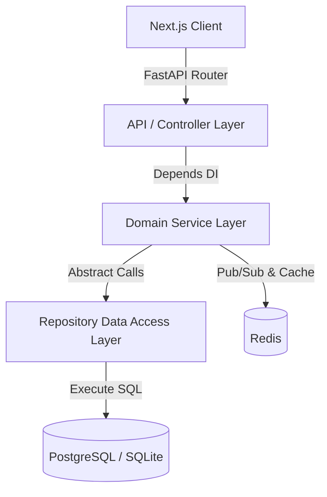

# Invexo Backend Architecture

This document describes the architectural layout, core design patterns, and decoupled module structures implemented in the Invexo backend.

---

## 1. Architectural Overview

The backend is built using **Clean Architecture** principles to separate business logic, data persistence, and HTTP transport layers. This ensures readability, ease of testing, and modularity.



---

## 2. Directory Layout

The `/backend/app` directory is structured as follows:

```
backend/app/
├── api/
│   └── v1/
│       ├── dependencies.py    # Common FastAPI Dependency Injection helpers
│       ├── endpoints/         # Controllers/routers for resources
│       │   ├── admin.py
│       │   ├── advisor.py
│       │   ├── auth.py
│       │   ├── market.py
│       │   ├── news.py
│       │   ├── portfolio.py
│       │   ├── predict.py
│       │   └── search.py
│       └── router.py          # Unified Router assembling v1 routes
├── core/
│   ├── config.py              # Environment variable parser
│   ├── database.py            # PostgreSQL pool and SQLite compatibility layer
│   ├── limiter.py             # SlowAPI Rate limiter instance
│   ├── redis.py               # Redis client with in-memory test fallback
│   └── security.py            # JWT cryptographics, password hashing, and token checks
├── models/                    # Data transfer models (SQL database schemas)
├── repositories/              # Raw data layer, abstracting queries away from services
│   └── user_repository.py
├── schemas/                   # Pydantic input/output validation schemas
│   ├── auth.py
│   └── portfolio.py
├── services/                  # Core domain & business logic
│   ├── auth/
│   │   └── auth_service.py
│   ├── calculator/
│   │   └── calculator_service.py
│   └── market/
│       ├── advisor_service.py
│       ├── general_news_service.py
│       └── ticker_utils.py
└── utils/
    └── logger.py              # Global logging wrappers
```

---

## 3. Core Design Principles

### Separations of Concerns (SoC)
* **API Endpoints (Controllers)**: Declare paths, inputs/outputs (Pydantic schemas), rate limits, and authentication requirements. They delegate execution immediately to service layers.
* **Services (Business Logic)**: Handle validations, computations, algorithm calculations (such as XGBoost prediction integrations, portfolio returns, or SIP parameters), and caching.
* **Repositories (Data Access)**: Formulate queries, interface with connections, and map DB results to dictionaries/objects.

### Dependency Injection (DI)
The system leverages FastAPI's `Depends` for request context logic:
* **Authentication**: Decodes tokens and fetches current active user models (`get_current_user`).
* **Role-Based Access Control (RBAC)**: Validates if the authenticated user possesses premium or admin role privileges (`require_role(["premium", "admin"])`).
* **Rate Limiting**: Integrated using `SlowAPI` with `limiter.limit` decorators.
